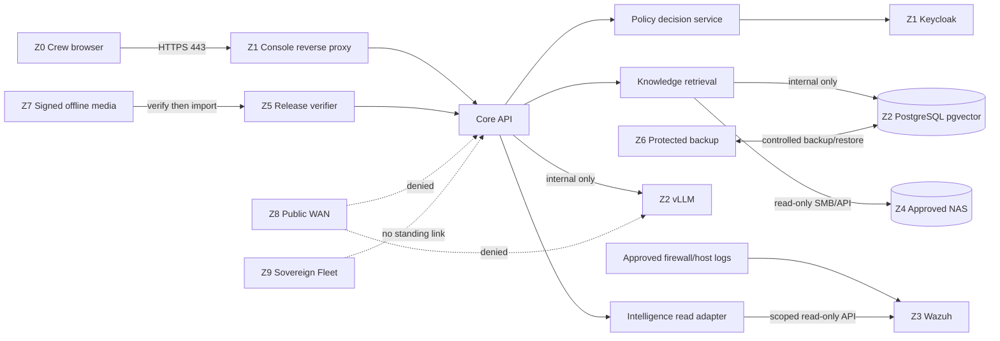
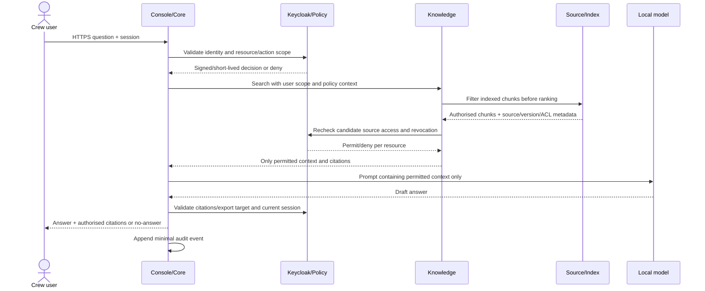

# Logical architecture, data flows and trust boundaries

**Status:** reference design for the isolated lab and a future vessel. VLAN numbers, IP addresses, hostnames, certificates, NAS ACL semantics and telemetry feeds require a site survey and explicit approval. The first-vessel design must replace the placeholders before installation.

## Trust zones

| Zone | Contents | Trust rule |
|---|---|---|
| Z0 Crew/user | Approved laptops and browsers; potentially compromised clients | HTTPS to Console only; no direct database, model or SIEM API |
| Z1 AI application | Reverse proxy, Console, Core, Knowledge, Policy, Keycloak | Only named internal service routes; no public WAN egress |
| Z2 Model/data | vLLM, embeddings/reranker, PostgreSQL/pgvector, local model files | Reachable only from Z1 service identities; no crew route |
| Z3 Security | Independent Wazuh manager, indexer, dashboard and approved collectors | Receives approved telemetry; Intelligence reads via scoped API; survives Z1/Z2 outage |
| Z4 Source storage | Approved NAS shares and source ACLs | Read-only ingestion identity scoped to allowlisted folders; source remains authoritative |
| Z5 Management | Named administrators, internal PKI, DNS/NTP, backup control | Dedicated management path; MFA/break-glass; no general crew access |
| Z6 Backup | Separate protected copies and restore media | Restricted write and separate restore custody; no model access |
| Z7 Transfer/staging | Connected preparation workstation and scanned encrypted media | One-way controlled import of approved signed bundles; never a standing network bridge |
| Z8 Vessel WAN | Existing vessel internet and cloud services | May serve non-AI vessel users; AI/service subnets deny public egress |
| Z9 Company Fleet | Customer, licence, release and support portal | No automatic connection to strict-mode vessel; authorised offline/admin records only |

## Component and route diagram

## Request and ingestion flow

1. An ingestion worker reads only allowlisted source paths under a read-only identity. It records source ID, owner, classification, version/hash and effective access metadata before chunking or embedding.
2. Parser output is untrusted data. It never becomes an instruction for Core, Policy or tools. Malformed files go to quarantine with a bounded error report.
3. Source ACL changes or deletion trigger index and cache invalidation. A failed synchronisation or uncertain permission blocks retrieval until reconciled.
4. Index, citation and preview paths enforce the same resource decision. The model sees only authorised context, and the response layer rechecks access before display.
5. Wazuh receives telemetry independently. The Intelligence adapter has only selected read endpoints and returns event IDs, timestamps and asset identifiers; the model explains but cannot issue a configuration change.

## Data-flow and storage register

| Flow | Origin → destination | Data | Rule and audit |
|---|---|---|---|
| F01 | Crew browser → Console/Core | Session, question, selected collection | HTTPS; local authentication; request and decision IDs logged |
| F02 | Core → Policy/Keycloak | User claims, resource/action | Internal API; default deny; decision and policy version logged |
| F03 | Knowledge → NAS | Allowlisted files, source ACL metadata | Read-only identity; bounded folder scope; import/hash recorded |
| F04 | Knowledge → local index | Parsed chunks, embeddings, labels | Encrypted local storage; provenance and ACL metadata; no raw file in audit log |
| F05 | Core → local model | Prompt with authorised context | Internal-only endpoint; request limits; no WAN route |
| F06 | Approved devices → Wazuh | Syslog/agent events | Explicit source list; no credentials in payload; retention rule |
| F07 | Intelligence → Wazuh | Read-only alert/event queries | Scoped service identity; query IDs and returned event IDs logged |
| F08 | Application/DB → backup | Configuration, database, key material under separate custody | Encrypted protected target; scheduled verification and restore evidence |
| F09 | Offline media → release verifier | Signed software/model bundles | Media scan, hash/signature check, manifest and rollback record |
| F10 | Admin → identity/configuration | User, role, source, release changes | Dedicated management segment; MFA; change and approver recorded |
| F11 | Company Fleet ↔ authorised operator | Vessel metadata, licence, support and release records | Administrative/offline procedure only; no automatic vessel data feed |

## Preliminary port and route matrix

All entries are **logical allowances**, not firewall commands. Site implementation must specify source/destination IP, protocol, TLS mode, owner and test ID. Deny all unlisted routes. Default product ports below follow official [Wazuh architecture](https://documentation.wazuh.com/current/getting-started/architecture.html), [Keycloak reverse proxy](https://www.keycloak.org/server/reverseproxy), and [vLLM serving](https://docs.vllm.ai/en/latest/serving/online_serving/openai_compatible_server/) documentation; configured ports may differ.

| ID | Source → destination | Proto/port | Purpose | Exposure |
|---|---|---|---|---|
| P01 | Z0 crew → Z1 reverse proxy | TCP 443 | Console and authenticated API | Crew subnet to proxy only |
| P02 | Z1 proxy/Core → Keycloak | TCP 8443 or internal chosen port | OIDC login/token validation | Internal only; no direct model access |
| P03 | Z1 Core → Z2 vLLM | TCP 8000 chosen internal port | Inference | Only Core identity/network; vLLM API key is insufficient alone |
| P04 | Z1 Knowledge/Policy → Z2 PostgreSQL | TCP 5432 | Metadata and vector index | Named services only |
| P05 | Z1 ingestion → Z4 NAS | TCP 445 for SMB, or approved NAS API | Allowlisted document read | Read-only identity; deny broad mounts |
| P06 | Approved agents → Z3 Wazuh manager | TCP 1514; TCP 1515 only when enrolling | Agent events and enrollment | Named endpoints; enrollment closed outside window |
| P07 | Approved log source → Z3 collector | UDP/TCP 514 only if configured; prefer protected transport where supported | Syslog | Named source IPs; verify confidentiality |
| P08 | Z1 Intelligence → Z3 Wazuh API | TCP 55000 | Read-only event query | Scoped account; no dashboard/admin route |
| P09 | Z3 Wazuh internal → indexer | TCP 9200, plus cluster ports only if topology requires | SIEM storage | Security segment only |
| P10 | Z1/Z2/Z3/Z5 → approved local DNS/NTP | UDP/TCP 53, UDP 123 as needed | Local resolution and time | Local server only; test fallback/no external forwarding |
| P11 | Z5 admin → managed hosts | SSH 22 and HTTPS management ports as approved | Maintenance | Named admin workstation; time-limited |
| P12 | Backup agent → Z6 backup target | Product-specific, to be chosen | Encrypted backup | Dedicated identity and target |
| P13 | Z1/Z2/Z3 → public WAN | None by default | Explicitly denied | Log and packet-test IPv4/IPv6/DNS/proxy paths |

## Egress, time, DNS and operations

- The vessel WAN may remain usable for crew networks. FortiGate plus host/container policy denies public routes from AI application, model and index workloads. The security server is also offline by default; signed threat-intelligence snapshots can be imported through the offline release path.
- Local DNS must not forward AI-zone queries externally. Local NTP or a vessel-approved time source is required for certificate and audit integrity; a time-source failure raises a local health alarm.
- Updates, crash reports, model downloads, package managers and licence checks are disabled onboard unless separately designed and authorised. The bundle manifest includes every required artifact.
- Backup copies, keys and release-signing keys have separate custodians. The model never sees key material or raw backup content.
- Audit records use a canonical event schema with sequence number, prior-record hash and current-record hash. Forward a copy to the independent security host where feasible. The local verifier checks gaps and hash continuity; this makes tampering detectable, not impossible. Access to both copies is separated from ordinary application administrators.
- Management BMC/IPMI interfaces belong to Z5 with separate access controls; they are not exposed to crew or WAN.

## Lab-to-vessel transition

The lab replaces NAS and network devices with synthetic fixtures, a test NAS, virtual firewall and a separate Wazuh VM/host. Legacy 4 log exports or configuration snapshots may be used only after a written, narrow approval and sanitisation. This design does not establish that the listed FortiGate, Cisco, MikroTik, UniFi or QNAP systems are accessible or compatible on the vessel. Site survey T-032 and approval T-033 must resolve that before Phase 7.
