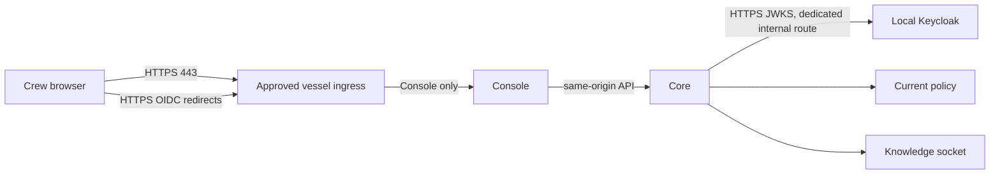

# Vessel identity integration contract

**Status: partial runtime implementation for synthetic validation, not an approved vessel
configuration.** The current signed vessel installer is a schema-1 lab path:
it accepts only `{"schema":1,"oidc_issuer":null}`, mounts a lab password into
Core, and records that password path in install, switch and recovery state.
Core can validate a DNS-named HTTPS Keycloak issuer and a private CA file, but
the vessel installer does not yet supply either. An issuer in Console alone
would produce an unusable or misleading sign-in path, so the mode transition
must be atomic across Console, Core, status, backup and recovery.

The runtime now has an opt-in OIDC branch that validates an exact HTTPS realm,
owner-only CA and revocation files, and a labelled internal identity network.
It mounts no lab password, connects only Core to that network, and probes the
Console issuer and TLS JWKS. The installer cannot select this branch yet; its
state, release switch and recovery records are still schema 1. This code is
not evidence of an installable OIDC vessel release.

## Required behavior

- A strict vessel release uses one named, local HTTPS Keycloak realm for crew
  login. Browser and Core must see the **same issuer URL**. Core checks the
  signed Core audience and Console client, then rechecks the current local
  user and role policy on each request.
- OIDC mode does not mount, accept or record the synthetic lab password. A
  schema-1 installation remains lab-only and cannot become OIDC merely by
  changing a Console JSON file or an environment variable.
- Core reaches the realm through an approved internal identity route with no
  public egress. Console and crew browsers reach the approved HTTPS ingress;
  no crew route reaches Core, PostgreSQL or model serving directly.
- A trusted CA and a nonempty identity configuration are provisioned before
  Docker resources are created. The OIDC revocation file is initialized as a
  private empty log and remains available through switch, rollback, restart
  and restore. Missing or unsafe identity material refuses activation.
- Recovery of Core state alone is insufficient for identity acceptance:
  Keycloak's persistent accounts, signing keys and configuration need a
  separately checked backup and clean restore before crew login is accepted.

## Proposed local topology

The identity route must be explicit. The current vessel Docker network is
`--internal` and contains only Core and Console; it cannot be assumed to reach
Keycloak. A candidate dedicated internal identity network would attach Core
and Keycloak, with no default public route. The issuer hostname must resolve
to the same TLS identity inside that network and from approved browsers.
Adding a second Core network requires changing runtime inventory, health,
orphan cleanup, status and release recovery checks together. The network name,
DNS mapping and certificate chain are site decisions; no value in this design
authorizes a vessel firewall or DNS change.

## Proposed schema-2 state contract

| Record | Required OIDC fields and checks |
|---|---|
| Signed release stage | Existing bundle and exact Console JSON remain hash-bound to the stage. The Console issuer is a strictly validated HTTPS realm URL and must equal the Core issuer. |
| Private installation state | Record `identity.mode=oidc`, issuer, external Core-state path, CA path and SHA-256, revocation-log path, and identity-network identity. Do not include a lab password. Reject mixed lab/OIDC keys and unknown schema fields. |
| Core state | Owner-controlled policy and source files plus owner-only CA and revocation log. Core may append revocations but must not receive the Keycloak server's signing or administrator keys. |
| Restore intent | Bind identity mode and exact source release before creating volumes. A resumed or abandoned attempt must check the same mode, paths and labelled network resources. |
| Recovery set | Encrypt the CA and revocation log with the existing Core files; bind their hashes in the signed receipt. Verify them before starting services. Keycloak itself needs an independent, coordinated restore gate. |

Use an explicit state schema increment. A schema-1 record never silently
acquires schema-2 meaning, and update/rollback cannot switch identity modes
without a separately approved migration and recovery test. A changed CA needs
a controlled trust-rotation procedure, including old/new overlap and failure
rollback. A revocation log changes during normal logout, so its live bytes
cannot be pinned to a static active-state hash; capture must freeze writes and
record an exact snapshot hash. Local file checks alone cannot detect a valid
looking truncation by an actor who controls both application state and its
audit copy. Protect and independently anchor that state before a pilot.

## Activation and recovery decisions

1. Preflight the signed bundle, Console issuer, Core identity configuration,
   CA, revocation log, protected storage and approved identity-network handle
   before creating a new installation root or candidate stage.
2. Start Knowledge as today. Start Core only with its OIDC issuer, checked CA
   mount, persistent revocation path and scoped identity network; do not mount
   the lab credential. Start Console with the matching staged JSON.
3. Probe Core's exact environment and mounts, identity-network membership,
   Keycloak JWKS over the approved TLS route, role-denial behavior and Console
   configuration before writing the active release record. A reachable JWKS
   does not prove that login, MFA or issuer continuity works.
4. On Keycloak outage or CA/issuer mismatch, refuse new authentication and
   report identity unavailable without falling back to lab sessions or a
   remote issuer. Do not mark an unhealthy candidate active.
5. Switch, rollback, stop/recover and clean restore must carry the same mode
   and check the exact CA, revocation and network resources. Restore identity
   service state before accepting crew tokens; if identity recovery is
   incomplete, retain private evidence and keep the candidate stopped.

## Synthetic acceptance matrix before target qualification

| Case | Expected evidence |
|---|---|
| First install with fictional HTTPS realm | Browser PKCE login and Core API succeed for an allowed role; denied role cannot retrieve, preview or cite an engineering source. |
| Wrong issuer, audience, client, TLS chain or CA | Authentication or preflight refuses; no lab fallback and no active pointer change. |
| Identity network disconnected | Keycloak cannot be reached from Core; API fails closed while independent security monitoring remains available. |
| Switch and rollback | OIDC mode, CA mount, role decisions and revocation state persist; candidate failure retains the previous release. |
| Clean restore and restart | Encrypted Core and Keycloak state restore independently; revoked token remains denied; missing or truncated log is detected or blocked by an independent anchor. |
| Interrupted activation | Wrong-attempt identity resource labels are refused; explicit cleanup preserves the active release and private evidence. |
| WAN available to other vessel networks | Packet and firewall evidence proves the identity path stays local and Core has no public egress. |

The first six rows can begin with fictional lab resources. The last row,
certificate issuance/renewal, MFA, persistent Keycloak recovery, network
routes and an independent role-bypass review remain under
[B-03, B-06, B-07 and B-08](../blockers-and-build-queue.md). This contract
does not close any of those gates.
